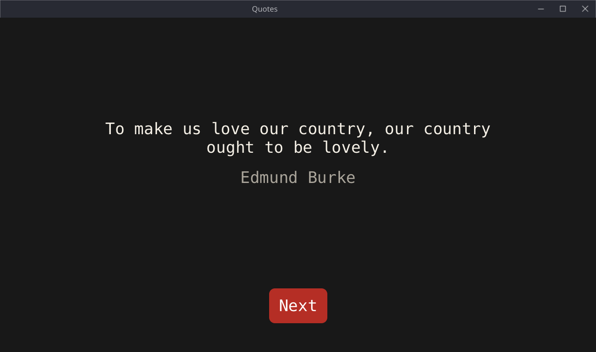

It's well known that distributing binaries for the Linux desktop is a difficult
challenge.
Go and similar languages bypass this by targeting the stable kernel ABI through
syscalls and statically linking everything else. Until... they have to put
something on the screen.
For more information, see [JangaFX's blog post][jangafx] about it.

The solution they propose is to link against the oldest glibc you want to
support (which is fairly easy now with zig cc). But that would mean perpetuating
the platform's bad practices.
And anyone who wants to use my application on a sane Linux system (like one
based on musl) would have to do weird hacks or I'd have to distribute a binary
for each libc.

But there are a few things we can utilize to make a statically linked graphical
application.

First of all, the X11 protocol has been stable since 1987, meaning we can just
statically link xcb.
We can't use OpenGL or Vulkan... But I'd argue that most applications (except
for games) can just do with software rendering.

So I was able to create this simple application by compiling xcb as a static
library against musl, with a basic software rendered immediate ui and text
rendering with stb\_truetype.



Now one might also want to play sounds. I first tried to use ALSA but this came
up:

```sh
ALSA lib ../../src/alsa-lib-1.2.14/src/dlmisc.c:339:(snd_dlobj_cache_get0)
Cannot open shared library libasound_module_pcm_pipewire.so ()
```

ALSA dlopens its plugins (PipeWire in this case) and musl's static builds don't
support dlopen.

PipeWire also has compatibility with PulseAudio though. And after a [small
patch][pulseaudio-patch] to remove libsndfile dependency, I was able to compile
PulseAudio statically against musl. And since PulseAudio library implements a
protocol, it worked!



I think this is why the Linux desktop ends up defining protocols instead of
providing an ABI, this is the best you can do on a platform with fundamentally
broken dynamic linking (at the cost of having processes running whose sole
purpose is waiting for messages and responding to them).

This is one way to achieve this and again, if you want to use the GPU, you have
to find a way to implement dlopen. There are [attempts at
this][godot-static-post] and I will post a part two if it's possible to
achieve this reliably.

The source code for the final application can be found at
<https://github.com/yasinkaraaslan/linux-quotes>.

[jangafx]: https://jangafx.com/insights/linux-binary-compatibility
[pulseaudio-patch]: https://github.com/yasinkaraaslan/linux-quotes/blob/master/vendor/pulseaudio-static.patch
[godot-static-post]: https://github.com/quaadgras/graphics.gd/discussions/242
